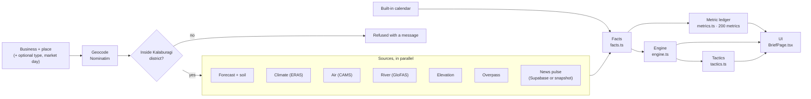

# Daily Business Brief (Kalaburagi)

The brief tells a small business or farm in Kalaburagi district whether to **push**, **run a normal day** or **protect** tomorrow. It explains every part of that call.

This document describes what the code in `src/brief/`, `src/components/brief/`, `src/pages/BriefPage.tsx` and `supabase/functions/local-pulse/` does. It was checked against that code on 2026-10-27. Where something is approximate, inferred or not yet working, it says so.

## 1. What it does

The user types two things: what the business is (for example "saree shop", "lassi stall", "tur farmer, 4 acres" or "dairy, 6 cows") and where it is in Kalaburagi district. Optionally they also choose a business type and the day of their weekly market (santhe). The page then shows:

- **A verdict for tomorrow** (push, normal or protect), a 0–100 opportunity index, a one-line headline and a confidence score.
- **Actions**, ranked by priority. Each one names the measurements it rests on.
- **Tomorrow hour by hour**: temperature, feels-like temperature, rain chance and amount, UV and wind. Next to it, a map of mapped competitors within 2 km.
- **The Kalaburagi news pulse**: posts that beat their channel's usual views, events and notices announced for the coming days, competitors' adverts, topics, and the places most in the news.
- **A 7-day outlook** scored the same way.
- **Why this call**: each driver's signal, the business's weight for it, and its contribution.
- **Coming up**: holidays and local events for the next 45 days, each with its source.
- **Every number**: a ledger of 200 measurements, each with its value, unit, source and method. A measurement whose source failed shows "Unavailable". It is never filled in from another place or day.
- **Sources**: which of the 9 sources answered this time, and why any failed.

Everything is computed in the browser from free public data. No language model writes a number, a rule or an action. The page stores only the last form input, in the browser's `localStorage` under `ishaara.brief.lastInput.v1`. The brief page is in English only.

## 2. Scope: Kalaburagi district only

The brief covers Kalaburagi (Gulbarga) district only. The calendar, the news channels, the Urs weighting and the place list are all specific to it.

- Typed text is sent to the geocoder with ", Kalaburagi, Karnataka" appended (`districtQuery`). If the text already names the district, only ", Karnataka" is appended.
- `inKalaburagiDistrict` accepts a resolved place only if all three of these hold:
  - the geocoder's district or display name matches Kalaburagi, Gulbarga, Kalburgi or ಕಲಬುರಗಿ;
  - the state is Karnataka;
  - the place is within 110 km of the city centre (17.3297° N, 76.8343° E). The district is roughly 160 km across.
- A place that fails the check gets a message asking for a place inside the district, and no brief is built.
- The place field suggests the taluk headquarters plus Ganagapur. Any town, village or area name can be typed.

## 3. Architecture



`runBrief` (`src/brief/runBrief.ts`) runs the whole pipeline. It is pure apart from the network calls, and the tests inject those.

### 3.1 Sources (`sources.ts`, `pulse/load.ts`)

| # | Source id | Service | Request |
|---|---|---|---|
| 1 | `geocode` | OpenStreetMap Nominatim | The app's existing rate-limited geocoder (`src/lib/geo.ts`): first match in India, at most 1 request per second |
| 2 | `forecast` | Open-Meteo Forecast API | 13 hourly and 17 daily variables, 16 days ahead and 7 days back, Asia/Kolkata time. Soil moisture (3 depths), soil temperature and vapour-pressure deficit come from a **separate request**, so one rejected variable cannot sink the weather. They are reported under this source |
| 3 | `climate` | Open-Meteo Historical Weather API (ERA5 reanalysis) | Daily max/min temperature and rain for the 10 most recent complete calendar years |
| 4 | `air` | Open-Meteo Air Quality API (CAMS) | Hourly PM2.5, PM10, US AQI, ozone and dust, 3 days |
| 5 | `river` | Open-Meteo Flood API (GloFAS) | Daily discharge with ensemble median and maximum, 16 days. If the statistics are rejected, it retries for the plain discharge at the same spot |
| 6 | `elevation` | Open-Meteo Elevation API (Copernicus DEM) | One value |
| 7 | `osm` | OpenStreetMap Overpass API | One count query covering 29 feature classes, plus counts of similar businesses within 500 m, 1 km and 2 km. A second query lists competitors with names, for the map. Two public mirrors are raced and the first success wins |
| 8 | `calendar` | Built in (no network call) | See section 5 |
| 9 | `pulse` | Supabase tables `pulse_items`, `pulse_item_stats`, `pulse_runs` | Read with the public anon key. Falls back to the saved snapshot; see section 4 |

Rules every source follows:

- **No keys.** None of the nine sources needs an API key.
- **Failures are labelled.** A failure comes back as one of `rate_limited`, `timed_out`, `unreachable`, `no_match`, `bad_response`, `not_configured` or `out_of_area`, with a message. Nothing is ever substituted from another place or time.
- **Overpass errors count as failures.** An Overpass answer with HTTP 200 and a "runtime error" remark is treated as a timeout, not as "nothing mapped here".
- **Only successes are cached.** Successful answers are stored in the app's existing 3-hour scan cache and shown as cached when reused.
- **Timeouts.** 12 s by default, 20 s for the climate archive, and 30 s for Overpass.

### 3.2 Facts (`facts.ts`)

Facts are the typed numbers that both the ledger and the engine read, so a number shown and a number scored are always the same number.

- **Days.** Per-day facts are built for tomorrow and the six days after it. Rain totals use every forecast day, up to 15, and a separate summary covers the past 7 days.
- **Trading and field hours.** Trading hours are 07:00–21:00 (15 h). Field hours are 06:00–18:00 (13 h).
- **Minimum data.** A day needs at least 20 hourly rows before hour-count figures are computed (comfortable hours, hot hours, field hours and the like); with fewer they stay null. Air and soil facts for tomorrow need at least 12 hourly rows.
- **Climate normals.** The mean, spread, record, rain chance and normal rain for each date come from all archive days within ±7 calendar days of that date, across the 10 years.
- **Competitors** are sorted by straight-line distance from the place.

### 3.3 Metric ledger (`metrics.ts`)

Each metric has an id, a dimension, a label, a value, a unit, a display string, its source and a one-line method. Many also carry a published reference band, such as an IMD rain category, NOAA heat-index bands, CPCB NAAQS limits or WHO UV categories. A null value displays "Unavailable".

A run produces **200 metrics** in 13 dimensions. These counts come from an actual run on the test fixtures on 2026-10-27:

| Dimension | Metrics |
|---|---|
| The decision (index, verdict, location strength, confidence) | 4 |
| Tomorrow's weather | 40 |
| The week ahead | 17 |
| Against the 10-year normal | 14 |
| Air quality | 9 |
| Soil, crops and livestock | 20 |
| Rivers and terrain | 6 |
| The place | 5 |
| Footfall anchors nearby | 32 |
| Competition nearby | 8 |
| Calendar and festivals | 19 |
| Kalaburagi news pulse | 19 |
| Data quality | 7 |

The published formulas the ledger uses are in `formulas.ts`, and each names its origin:

- NOAA heat index (Rothfusz regression)
- Environment Canada humidex
- Australian Bureau of Meteorology shade WBGT approximation
- Stull (2011) wet-bulb temperature
- NRC (1971) cattle temperature-humidity index, with Armstrong (1994) bands
- CPCB National AQI sub-indices from PM2.5 and PM10
- IMD rainfall and departure categories
- FAO-56 ET₀, taken as given by Open-Meteo
- A mean-synodic-month moon phase

### 3.4 Engine (`engine.ts`)

**Signals.** Each of 12 drivers becomes a signal `s` between −1 and 1:

| Driver | Signal |
|---|---|
| Heat | `(feels-like max − 33 °C) / 7`, clamped. 33 °C is neutral and 40 °C is full strength |
| Rain | `0.6 × (highest trading-hour rain chance / 100) + 0.4 × min(1, rain mm / 20)`, 0 to 1 |
| Comfortable hours outdoors | `(comfortable trading hours − 9) / 6`, clamped. A comfortable hour has feels-like 18–32 °C, rain chance under 40 % and no rain |
| Clean air | `1 − PM2.5 / 60`, clamped. **Tomorrow only**; left out for the other outlook days |
| Festival buying | 1 the day before a buying festival, then 0.8, 0.6, 0.4 and 0.2 at 2 to 5 days before; 0.6 on the festival day itself. Left out for dates outside the holiday lists' coverage |
| Weekend or holiday | Sunday 1, Saturday 0.5, a gazetted national or state holiday 1 |
| Salary week | Days 1–7 of the month 1, the last 5 days −0.5, otherwise 0 |
| Religious gathering | The strongest of: an Urs day (1 within 15 km of the city centre, 0.35 elsewhere in the district); Ramadan (0.4); a Friday with at least one mapped mosque within 1 km (0.3); around Purnima or Amavasya with at least one mapped temple within 1 km (0.25) |
| Warmer than normal | `(forecast max − 10-year normal max) / 4`, clamped |
| Field-work conditions | `2 × field hours / 13 − 1`, minus 0.5 if rain is 15 mm or more, clamped |
| Weekly market day | 1 on the market day the user entered, else 0. Left out if no market day was entered |
| Events in the local news | Sum over news-pulse events whose dates cover the day: gathering +0.6, disruption −0.6, offer +0.15, clamped. Notices are not counted |

**Weights.** Each of the 21 business types (`archetypes.ts`) has a weight `w` between −1 and 1 for each driver. The sign says which way the driver moves that business's demand or, for farms and livestock, its working conditions. The size says how strongly. Unless a type says otherwise, "events in the local news" has weight 0.5.

**Index and verdict.**

```
index   = 50 + 50 · tanh( Σ w·s / 2 )        (0 to 100; 50 is an ordinary day)
push    if index ≥ 65
normal  if 35 ≤ index < 65
protect if index < 35
```

**Missing data.** A driver whose signal is missing (`null`) is left out of the sum, not counted as zero.

**Confidence** = `round(100 × (0.7 × used weight / total weight + 0.3 × sources that answered / 9))`:

- *Used weight* is the summed |w| of drivers that had data.
- *Total weight* counts every driver, except the market day when none was entered.
- Confidence does not include forecast lead time. Lead time is shown separately, as the data-quality metric `dq.lead`.

**Overrides.**

- **Severe weather.** Tomorrow becomes **protect** for outdoor stalls, crop farms and livestock in IMD heavy rain (≥ 64.5 mm), gusts ≥ 60 km/h or a heat index ≥ 54 °C. In the 7-day outlook the same override applies to outdoor stalls only.
- **No forecast, no call.** If the forecast did not load, the index and verdict are empty and the headline says why.

**Location strength** is separate from tomorrow's index:

- It is a 0–100 footfall-anchor score: a weighted, log-scaled count of the mapped features that bring this business's customers.
- It is discounted by up to 35 % for similar businesses within 500 m.
- For business types that gain from clustering (clothing, sweets, mobiles, hardware, restaurants, street food, general shops, fruit and vegetables), the discount is at most 14 %.

### 3.5 Business types (`archetypes.ts`)

There are 21 types, from tea stalls, cold drinks, street food, restaurants, sweets, kirana, fruit and vegetables, clothing and tailoring, through flowers and puja items, mobiles, pharmacies, salons, stationery, hardware, lodging and transport, to dairy, poultry, crop farming and a general shop.

The type is picked from what the user typed by keyword, in English and Kannada. Longer, specific keywords beat generic ones, and words like "farmer", "acres", "grow" or ರೈತ move the match to the producer types. The user can override the type. If nothing matches, it falls back to "General shop", and the page says no keyword matched.

### 3.6 Tactics (`tactics.ts`)

Tactics are rule-based actions of four kinds: act, avoid, watch, or field (farm work). Each has a priority and lists the metric ids it rests on, and every number in its text is read from those metrics. A test checks that every metric id cited by a tactic, a driver or the location score exists in the ledger.

Farm and livestock tactics describe conditions to discuss with the local Krishi Vigyan Kendra (KVK) or a vet. They never name a pesticide, a dose or a seed variety, and a test checks this for a sample of product names.

### 3.7 UI (`src/pages/BriefPage.tsx`, `src/components/brief/`)

- **Where it lives.** The page is the `/brief` route, linked as **Brief** in the top bar and from the landing page.
- **While it loads.** A live source scan shows each of the 9 sources as it answers.
- **The result.** The sections, in order:
  1. Decision
  2. Actions
  3. Hour by hour, with the street map
  4. Local news
  5. Week
  6. Why this call
  7. Coming up and nearest competitors
  8. Everything considered
  9. The ledger
  10. Sources
  11. How the call is made
- **Printing.** A Print button prints the page.

## 4. The Kalaburagi news pulse

### Channels followed

The channel list is `supabase/functions/_shared/pulseSources.ts`. The app and the collector both import that file, so they cannot disagree.

- **YouTube (5):** gohash, Gulbarga Headlines, Gulbarga News, Gulbarga 24 News, Kalaburagi 24.7. These are read from each channel's public RSS feed, which needs no key and returns the latest 15 uploads.
- **Instagram (4):** Gulbarga Ki Awaaz, gohash.in, Gulbarga News, Kalaburagi 24/7. These are read through Apify's `instagram-scraper` (12 posts per profile per run), only when an `APIFY_TOKEN` secret is set.

### The optional live collector

`supabase/functions/local-pulse/index.ts`, with the tables from migration `202610220001_local_pulse.sql`:

- **Who can call it.** It accepts only `POST` requests carrying the header `x-pulse-secret` equal to the `PULSE_CRON_SECRET` secret. If that secret is not set, it answers 503; if the header is wrong, it answers 401. The browser never calls it.
- **What it stores.** Posts are upserted into `pulse_items`. Each run also stores a views snapshot per post in `pulse_item_stats`, and one outcome row per source in `pulse_runs`.
- **Failures.** Each source succeeds or fails on its own, and a failed source writes no posts.
- **Access.** The tables can be read by anyone and written only with the service role. There is no insert, update or delete policy for anon or signed-in users.
- **Schedule.** The function's header comments give an example `pg_cron` schedule: every 3 hours, using `pg_net`.

**Set-up:**

1. Apply the migration (`npx supabase db push`).
2. Deploy the function (`npx supabase functions deploy local-pulse`).
3. Set `PULSE_CRON_SECRET` with `npx supabase secrets set …`. Optionally also set `APIFY_TOKEN`, after checking Apify's current pricing.
4. Schedule the call.

Never put either secret in `.env.local` or in a `VITE_` variable.

### What the browser reads

`loadPulseFromSupabase` reads three things from the tables:

- posts from the last 35 days (up to 600);
- views snapshots from the last 48 hours, used to compute views gained over about a day;
- the latest run per source.

It reports `not_configured` in three cases: no Supabase client is configured, the tables are missing, or there are no posts yet.

### The labelled snapshot

**When the live pulse is unavailable, the news section uses a saved snapshot. This is the normal case today.**

- **What it is.** `pulse/snapshot.ts` holds 124 real posts from 5 YouTube channels, captured on **22 Oct 2026 at 03:45 IST** from the public channel pages while logged out, exactly as YouTube showed them.
- **How it is shown.** It is analysed as of its capture time. The section shows an amber notice naming the capture time, and every post links to the original.
- **Live check.** On 2026-10-27 the Supabase project this repository is connected to did not have the pulse tables, so the snapshot was what the brief showed.

Limits of the snapshot:

- **No Instagram posts.** Gulbarga Ki Awaaz is followed on Instagram only, so it does not appear in the snapshot, even though the section's subtitle lists it.
- **Approximate posting times.** Times are worked out from YouTube's "3 days ago" text. View counts are YouTube's rounded figures, such as "3.4k".
- **No "rising" posts.** That list needs views snapshots from collector runs about a day apart, and the snapshot has none.
- **Old events for local news.** The "events in the local news" driver still reads events from the snapshot. It can only see events announced on or before 22 Oct 2026. Once those dates have passed it contributes nothing, and its explanation says no event was announced "in the posts collected".

### How posts are read (`pulse/analyze.ts`, `pulse/text.ts`)

All of this is deterministic text rules, so every claim links back to the post it came from.

- **Outliers.** A post's views are divided by the median of its own channel and format; a short and a long video are compared separately. A post counts as an outlier at 1.5× or more. The ratio is only computed when there are at least 5 posts to compare.
- **Topics.** Keyword rules sort posts into 12 topics. The rules cover English, Hinglish, Urdu written in Latin script, and Kannada.
- **Scope.** A post is "local" when it names a Kalaburagi locality or marker, "outside" when it names somewhere else, and "unclear" otherwise. Outside posts are left out.
- **Events.**
  - **Kind.** Each event is classed as a gathering, disruption, offer, notice or deadline, by keywords.
  - **Written dates.** Dates written in a post are found in forms such as "Oct 15–18", "4th May" or "21/10/2026". When no year is written, the year is inferred: the one that puts the date nearest the post date, allowing up to 60 days back.
  - **"Tomorrow" and "today".** These count only when the posting day is known: an exact posting time, or an approximate one no more than about 2.5 days old.
  - **Bulletins** carry only their own date stamp, so they are skipped.
- **Window.** Most figures use the last 14 days.
- **Competitor adverts** are promotional posts that read as the user's line of business.

## 5. How calendar dates are found

### Holidays

- **Gazetted holidays** are copied, not computed, from the DoPT orders for central government offices: 2026 (October to December) and 2027 (F. No. 12/2/2023-JCA).
- **Coverage.** The table covers **2026-10-01 to 2027-12-31**. Outside that range the festival driver is left out and the ledger says the calendar does not cover the date.
- **Karnataka.** Kannada Rajyotsava (1 November) is added for places in Karnataka. Balipadyami (10 Nov 2026) and Kanakadasa Jayanthi (27 Nov 2026) come from the Government of Karnataka 2026 holiday list.
- **Regional festivals.** Festivals that are major observances only elsewhere (Karwa Chauth, Chhath, Onam and others) are left out of Kalaburagi's list. Which festivals count as regional is an editorial judgement in `calendar.ts`, not part of the DoPT orders.

### Kalaburagi events (`kalaburagi.ts`)

Each event names its source:

| Date | Event | Basis |
|---|---|---|
| 23 Oct 2026 | North-East Teachers' Constituency poll | Election Commission (PTI); Regional Commissioner, Kalaburagi division |
| 27 Oct 2026 | Teachers' Constituency vote count, Gulbarga University | Regional Commissioner, Kalaburagi division |
| 23 Dec 2026 | Datta Jayanti at Ganagapur | Margashirsha Purnima, from a festival-calendar site; the page tells users to check with the temple |
| 27 Mar 2027 | Sharanabasaveshwar Jatra and Rathotsava | **Inferred**: four days after Holi, as in 2022 and 2023; Holi 2027 is 23 Mar (DoPT) |
| 14 Apr 2027 | Dr B. R. Ambedkar Jayanti | Karnataka general holiday every year |
| 17 Sep 2027 | Kalyana Karnataka Utsava | Observed every 17 September |

### Islamic dates

- **How they are computed.** Islamic dates are computed in the browser from the Umm al-Qura calendar (`Intl`, `islamic-umalqura`), then **shifted one day later**. The Indian date for day *d* is the Umm al-Qura date of *d − 1*.
- **Why the shift.** India's observed dates ran one day behind Umm al-Qura on every date checked:
  - Id-ul-Fitr 2027: DoPT 10 Mar, Umm al-Qura 9 Mar.
  - Id-ul-Zuha 2027: DoPT 17 May, Umm al-Qura 16 May.
  - Muharram 2027: DoPT 16 Jun, Umm al-Qura 15 Jun.
  - Milad-un-Nabi 2027: DoPT 15 Aug, Umm al-Qura 14 Aug.
  - The 622nd Urs of Bande Nawaz was held 3–5 May 2026, where Umm al-Qura would give 4 May for its last day.
- **Missing calendar.** If the browser does not support that calendar, Islamic dates are unavailable rather than guessed.
- **Computed observances.** Shab-e-Barat (15 Sha'ban), the start of Ramadan, Shab-e-Qadr (27 Ramadan), the Bakrid livestock-buying week (from 3 Dhu al-Hijjah), the Jhela ceremony (about one month before the Urs; **approximate**), and the **Urs of Khwaja Bande Nawaz** (15–17 Dhu al-Qadah).
- **Already listed by DoPT for 2027.** Id-ul-Fitr, Id-ul-Zuha, Muharram and Milad-un-Nabi are not repeated.
- **Caveat.** Every computed Islamic date carries a note that the local moon sighting can move it by a day.

### Moon phase, paydays and seasons

- **Moon phase.** Approximated from the mean synodic month (29.530588853 days) counted from the new moon of 6 Jan 2000, 18:14 UTC. It is good to about a day, and labelled approximate.
- **Salary week and month-end.** Salary week is days 1–7; month-end is the last 5 days. These are conventions, not data.
- **Seasons.** IMD seasons, and kharif, rabi or zaid crop seasons, are set by month.

## 6. Limits: what is approximate, inferred or not yet working

- **The weights are judgement, not fitted.** Each business type's weights are hand-written rules of thumb, kept in the open so they can be argued with. They have not been fitted to or validated against any sales or yield data.
- **Weather is a model forecast.** Confidence measures how much of the evidence was available, not how accurate the forecast is.
- **Approximate or inferred dates:**
  - Islamic dates: computed; can move a day with the moon sighting.
  - The Jhela ceremony: approximate.
  - The 2027 Sharanabasaveshwar Jatra: inferred from past years.
  - Datta Jayanti 2026: taken from a festival-calendar site.
  - Moon phase: about ±1 day.
  - Holiday coverage ends on 2027-12-31.
- **OpenStreetMap counts only what volunteers have mapped.** Sparse areas understate what is there; the ledger's map-detail metric flags this. Overpass is a shared public service and can rate-limit. In the 2026-10-27 live check it answered "rate limited" on both attempts, and those 43 metrics showed as unavailable.
- **Approximate measures.** Thunderstorm risk, fog hours, leaf wetness, spray windows, field hours and drying hours are threshold rules over the hourly forecast, not measured. The Indian AQI here uses PM2.5 and PM10 only. Soil moisture is a model value. The river figure is the nearest ~5 km GloFAS cell, which may not be the stream that matters locally. Air quality is forecast for tomorrow only.
- **Geocoding takes the first match in India.** The district check guards against a wrong match outside the district, but an ambiguous name inside it can still resolve to the wrong spot.
- **The news pulse is keyword rules.** It can miss posts phrased in ways the rules don't list, and it can misread quotes or sarcasm. Section 4 covers the snapshot's limits.
- **Farm and livestock guidance stops at conditions.** It never recommends a product, dose or variety, and defers those decisions to the KVK or a vet.

## 7. Tests and checks

Run on 2026-10-27 at commit `2ef7204`:

| Check | Result |
|---|---|
| `npx vitest run src/brief` | **57 passed** (38 in `src/brief/brief.test.ts`, 19 in `src/brief/pulse/pulse.test.ts`) |
| `npx vitest run` (whole app) | **1,330 passed, 29 skipped**, 0 failed (137 files: 132 passed, 5 skipped) |

**What the brief's tests cover:**

- Formulas against published reference values.
- The DoPT dates, the India Islamic-date shift, and the 2026 and 2027 Urs dates.
- The Kalaburagi-only check.
- Business-type matching.
- Source failure handling, including rate limits, bad JSON, timeouts, the Overpass "runtime error" remark and the mirror fallback.
- End-to-end briefs on synthetic data: a hot day pushes a lassi stall; heavy rain protects a street-food cart; a farmer gets field conditions and no pesticide names; there are 150 or more unique metric ids and every cited id exists; a missing forecast gives no call; a missing driver is dropped, not zeroed.
- The pulse parsers for YouTube RSS and Apify output, the snapshot, outlier and event rules, and the loader.

**What they do not cover:**

- No test calls a live service.
- The Edge Function's request handler (Deno) is not tested; only its shared parsers are.
- There are no UI tests for the brief page.
- None of the 36 Playwright end-to-end tests covers `/brief`.

**Live check (2026-10-27).** A brief for a tea stall in Kalaburagi city was run from a Node script against the real services, with no keys:

- **Answered:** forecast, climate, air quality, river and elevation.
- **Rate limited:** Overpass, on both attempts.
- **Not set up:** the pulse tables, so the snapshot was used.
- **Result:** 157 of the 200 measurements were available, the verdict was "normal" and confidence was 93.
- **Not exercised:** geocoding failed when the app's geocoder was called from Node, so the city's coordinates were passed in directly. Geocoding in the browser was not re-checked in this run.

## 8. Files

| File | What it holds |
|---|---|
| `src/brief/types.ts` | Shared types: sources, metrics, drivers, verdicts, the `Brief` object |
| `src/brief/runBrief.ts` | The pipeline |
| `src/brief/sources.ts` | Live source calls, caching, failure handling |
| `src/brief/facts.ts` | Per-day facts, climate normals, festival signal |
| `src/brief/metrics.ts` | The 200-metric ledger and the anchor score |
| `src/brief/engine.ts` | Signals, scoring, verdict, overrides, outlook, location strength, headline |
| `src/brief/archetypes.ts` | The 21 business types, their weights, keywords and map features |
| `src/brief/tactics.ts` | Rule-based actions |
| `src/brief/formulas.ts` | Published formulas and reference bands |
| `src/brief/calendar.ts` | DoPT holidays, Islamic calendar, date helpers |
| `src/brief/kalaburagi.ts` | District check, places, localities, Kalaburagi events, Urs weighting |
| `src/brief/pulse/` | News-pulse loader, saved snapshot, analysis and text rules |
| `supabase/functions/local-pulse/index.ts` | Optional collector (Edge Function) |
| `supabase/functions/_shared/pulseSources.ts` | Channel list and feed parsers, shared by the app and the collector |
| `supabase/migrations/202610220001_local_pulse.sql` | Pulse tables and read-only policies |
| `src/pages/BriefPage.tsx`, `src/components/brief/` | The page and its parts |
