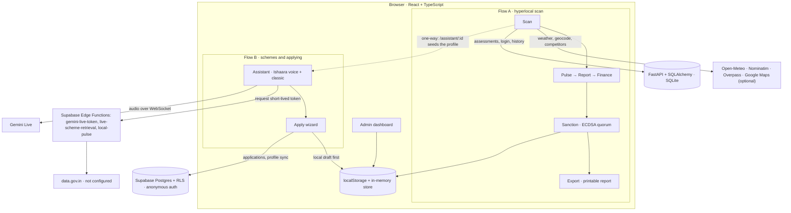
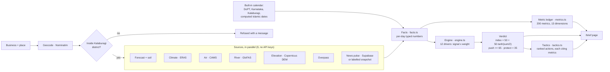

# Technical Design

Architecture, the two citizen flows, persistence, external services, and the scheme assistant's internals, in one place. This consolidates what was previously split between the README's Architecture section and `docs/ASSISTANT.md`; `docs/ASSISTANT.md` still exists as a focused deep-dive on the assistant specifically. For what is actually live vs. demo-only, [`HONESTY_LEDGER.md`](HONESTY_LEDGER.md) is the source of truth — this document describes how the system is built, not how reliable each part is.

## 1. Stack

**Frontend:** React 19, TypeScript, Vite 8, Tailwind CSS 4, React Router 7, i18next, Leaflet, Recharts, ethers 6.
**Backend:** FastAPI with SQLAlchemy and Alembic, on SQLite by default.
**Supabase:** Postgres with row-level security, anonymous auth, and three Edge Functions.

## 2. System diagram

## 3. The two citizen flows

**Flow A — Scan → Pulse → Report → Finance → Sanction → Export.** Orchestrated by `src/state/AppContext.tsx`.
1. `/scan` collects the profile and a location: one of 5 curated villages, or any place geocoded live.
2. The scan resolves the location, fetches weather, competitor density and (for curated villages) mandi signals. It then builds the NSFDC finance plan and computes the LokScore.
3. It opens an approval case with real ECDSA signing, and saves the assessment to the **FastAPI** backend.
4. `/pulse/:id`, `/report/:id`, `/finance/:id`, `/sanction/:id` and `/export/:id` reload the assessment from FastAPI. If the server is unreachable, they fall back to a local snapshot.
5. `/login` (phone + OTP) and `/history` belong to this flow.

**Flow B — Assistant + guided Apply.** Built on `src/assistant/**` and `src/backend/**`, independent of Flow A's state and backend.
1. `/assistant` opens the **Ishaara voice assistant**, a separate Vite entry at `/voice-assistant/` (`voice-assistant/index.html`, `src/voiceAssistant/`) with its own voice session code. `/assistant-classic` is the earlier chat-style assistant, whose voice also supports Hindi. Both use the same deterministic ranking and eligibility engine (`rankScore = eligibility × 0.7 + relevance × 0.3`, `src/assistant/ranking.ts`).
2. `/apply` (guided wizard) and `/apply/hub` (structured `LP-APP-*` workflow) save a tracked application to `localStorage` first. They then sync it to **Supabase** under the citizen's anonymous identity.

**The one bridge between flows:** opening `/assistant/:id` for a completed scan seeds the classic assistant with that scan's profile (`src/assistant/fromAssessment.ts`). It is one-way and purely client-side, and it is reached by URL; the navigation's Assistant link opens the Ishaara voice assistant.

The Daily Business Brief (`/brief`) is a third, separate flow, with its own sources, engine and state. It is in [section 11](#11-daily-business-brief-flow-brief).

## 4. Three persistence paths — they do not interoperate yet

| Path | Used by | Identity |
|---|---|---|
| **FastAPI + SQLAlchemy** (`server/`, Alembic migrations) | Flow A: assessments, `/history`, `/login` | Phone + OTP (fixed demo OTP `123456`), real bearer token |
| **Supabase** (Postgres + RLS) | `/apply` applications, assistant profile sync, voice token and live-retrieval Edge Functions | Anonymous Supabase auth, one identity per browser |
| **localStorage / in-memory** (`src/platform/store.ts`, `src/lib/approval/*`, `src/admin/**`) | `/sanction` approvals, the whole `/admin` dashboard, the local application draft | None, or the demo admin login |

**Nothing links these today.** A citizen signed in through FastAPI and the same citizen's anonymous Supabase identity are unrelated as far as the code is concerned. The admin dashboard reads neither backend. Choosing which model becomes canonical is an open team decision ([`handoffs/team-audit-2026-09-26.md`](handoffs/team-audit-2026-09-26.md) §7).

## 5. External services

| Service | Used for | State |
|---|---|---|
| Open-Meteo | Weather on `/scan` | Live, no key |
| Nominatim (OpenStreetMap) | Place search / geocoding | Live, no key; rate-limited to 1 request/second |
| Overpass (OpenStreetMap) | Nearby competitor density | Live, no key |
| Google Maps JavaScript + Places | Map location picking and competitor data on `/apply` and live-place scans | Optional; only with your own `VITE_GOOGLE_MAPS_API_KEY`. Without it, the Overpass and village-list paths are used |
| OpenStreetMap tiles | The jobs map on `/jobs` | Live, no key |
| Gemini Live | Voice assistant | Live; needs `GEMINI_API_KEY` as a Supabase secret |
| data.gov.in | Live scheme statistics | Wired end to end but **not configured** (no API key or dataset) |
| Ollama (local) | Optional local LLM for assistant explanations | Optional; the default is a deterministic offline provider |

## 6. Scheme assistant — pipeline

1. **Profile extraction.** `src/assistant/profileExtraction.ts` extracts a profile from the message using deterministic regex and keyword rules; no model is called. It is English-only: Hindi or Kannada input leaves fields blank rather than guessed (`src/citizen/profileFormDraft.test.ts`).
2. **Retrieval.** The profile is matched against the curated catalog (`src/assistant/data/schemes.ts`).
3. **Live retrieval (optional).** If Supabase is configured, the assistant attempts live official-source retrieval (`src/assistant/liveRetrieval.ts`).
4. **Evidence merge.** Live evidence is merged in without changing any eligibility rule (`src/assistant/evidenceMerge.ts`).
5. **Eligibility and ranking.** `src/assistant/eligibility.ts` and `src/assistant/ranking.ts` apply deterministic rules. The match score and status are computed, never produced by a model.
6. **Explanation.** An AI provider explains the evidence. Every reply passes `validateProviderReply` (`src/assistant/ai/responseGuard.ts`) before it is shown.

### AI providers

Providers are tried in order (`src/assistant/ai/index.ts`); the first one available answers.

1. **Local Ollama (optional).** Used when a local server answers the `/api/tags` health check at `http://localhost:11434` within 1.2 s. The default model is `llama3.1` (`src/assistant/aiConfig.ts`).
2. **Hosted model (disabled).** `src/assistant/ai/hostedProvider.ts` exists, but `HOSTED_PROXY_URL` is unset. A hosted model must only ever be called through a backend proxy that keeps its key server-side. No such proxy ships in this repo.
3. **Deterministic offline provider (the default).** Makes no external AI call.

### Source-status line

Every assistant reply shows what happened to live retrieval that turn (`src/components/assistant/SourceStatusBadge.tsx`; logic in `src/assistant/orchestrator.ts`):

| Label | Meaning |
|---|---|
| **Verified scheme knowledge base** | Live retrieval is not configured, so it was never attempted. The curated catalog was used. |
| **Official live sources checked · ⟨time⟩** | Live retrieval is configured and at least one source was queried successfully this turn. |
| **Live government sources unavailable · showing verified scheme data** | Live retrieval is configured, but every source failed or timed out. The curated catalog was used, and the ranking is unchanged. |

## 7. Curated scheme catalog

`src/assistant/data/schemes.ts` holds **14 hand-curated central and state schemes**, each with its official source URL and a `lastVerifiedDate`, marked `confidence: 'reference'` — meaning it must be re-verified against the official source before being relied on:

**Central (9):** NSFDC Micro Finance Scheme, NSFDC Term Loan Scheme, PMEGP, PM Mudra Yojana, Stand-Up India, PM Vishwakarma, NBCFDC Term Loan Scheme, PMMSY (fisheries), plus Kudumbashree Microenterprise Support as the first state entry.

**State, by southern state (6):**
- **Karnataka (4):** Udyogini (KSWDC), KMDC Self-Employment Scheme, KMVSTDCL Self Employment Direct Loan Scheme, KMVSTDCL Industries/Services/Business Scheme for Women.
- **Tamil Nadu (1):** NEEDS (New Entrepreneur-cum-Enterprise Development Scheme).
- **Kerala (1):** Kudumbashree Microenterprise Support.

Each state scheme was verified directly against that corporation's or department's own official page (KSWDC, the Tamil Nadu MSME Department, KMDC, KMVSTDCL) rather than a secondary aggregator; where two sources that both looked primary genuinely disagreed (notably NEEDS), the conflict is disclosed in that scheme's `eligibility.notes` rather than silently resolved.

Live retrieval only ever **adds** clearly sourced context to a scheme already in the catalog. It never creates a scheme, and never changes an eligibility rule, a loan amount or a document requirement.

Scheme content (names, descriptions, eligibility text) is English-only, to avoid mistranslating financial and legal specifics. The interface around it follows the app's English/Kannada toggle.

## 8. Live government-source retrieval

**Current state: not configured.** The `live-scheme-retrieval` Edge Function is deployed, but it returns `503 not_configured` until `DATA_GOV_IN_API_KEY` and `DATA_GOV_IN_RESOURCE_ID` are set as Supabase secrets.

**Sources investigated when this was built:**
- **[data.gov.in](https://data.gov.in)** has a genuine self-service API: free registration and a real key. It is the one live source implemented.
- **myScheme.gov.in** prohibits automated access in its Terms of Use. Its only sanctioned integration route, API Setu, is a partner-approval process. It is not scraped or called anywhere in this codebase.
- **Individual ministries** (PMEGP/KVIC, Mudra, NSFDC and others): no public self-service API was found.

**What data.gov.in provides:** the PMEGP/MSME datasets found are statistical data, such as units sanctioned or subsidy disbursed by state and year. They contain no eligibility rules, loan tables or scheme identifiers. So this evidence is classified `live_contextual`: useful context, but never proof about one specific scheme. It never changes eligibility, loan amounts or the computed match score.

**Evidence layer (`src/assistant/evidence/`)**

| Step | File | What it does |
|---|---|---|
| Fetch and normalize | `dataGovInConnector.ts` | Fetches and normalizes records |
| Deduplicate | `dedup.ts` | Removes duplicates; never merges across states |
| Bind to a scheme | `schemeBinding.ts` | Binds a record to one scheme only when the record itself carries an explicit scheme id or a matching official application URL |
| Report coverage | `coverage.ts` | Reports coverage honestly; `claimsAllGovernmentSchemesChecked` is hard-coded `false` |

Records that cannot be bound surface separately as contextual evidence.

**Timing:** calls are real-time per chat turn. The frontend times out at 4 s (`LIVE_RETRIEVAL_TIMEOUT_MS`) and the Edge Function at 6 s. Nothing is pre-fetched or refreshed on a schedule.

**Audit log:** every attempt is written to `scheme_retrievals`, including "not configured" attempts. The `schemes` table exists as cache infrastructure, but the Edge Function does not write to it.

**Trust model.** Every piece of evidence carries a `verification_status` (`src/assistant/types.ts`):

| Status | Meaning |
|---|---|
| `verified_local` | From the curated catalog, or live retrieval was not attempted this turn |
| `live_official` | Fetched this turn from an allowlisted official domain **and** deterministically bound to one scheme |
| `live_contextual` | Fetched from an allowlisted official domain but not bindable to one scheme; context only |
| `live_unverified` | Reserved; not currently produced (anything that fails validation is dropped) |
| `unavailable` | Live retrieval was attempted and failed |

**Allowlist:** every live source URL must be `https://` and on the official-domain allowlist, `src/assistant/trustedSources.ts`. That list is mirrored for the Edge Function in `supabase/functions/_shared/trustedDomains.ts`. Anything else is dropped. Field-level validation lives in `validateLiveEvidenceItems()` (`src/assistant/liveRetrieval.ts`) and `isWellFormedRecord()` (`src/assistant/evidence/governmentEvidenceOrchestrator.ts`). A malformed item is dropped, never repaired or guessed at.

## 9. Supabase setup

Supabase backs:
- the `/apply` application sync;
- the assistant profile sync;
- voice token minting;
- live retrieval.

Without it, the text assistant still works fully on the curated catalog.

1. Create a project at [supabase.com](https://supabase.com).
2. Copy `.env.example` to `.env.local` and set `VITE_SUPABASE_URL` and `VITE_SUPABASE_ANON_KEY`. The anon key is public by design; access is enforced by row-level security. Never put a service-role key in a `VITE_` variable.
3. Link the project and apply every migration in `supabase/migrations/`: `npx supabase db push`.
4. Deploy the Edge Functions:
   - `npx supabase functions deploy gemini-live-token`
   - `npx supabase functions deploy live-scheme-retrieval`
5. Set the secrets:
   - `npx supabase secrets set GEMINI_API_KEY=...` for voice.
   - Optionally, `DATA_GOV_IN_API_KEY=...` and `DATA_GOV_IN_RESOURCE_ID=...` for live retrieval.
6. Check the hosted schema: `npm run supabase:probe`.

For a local Supabase stack, use `npm run supabase:start`, `supabase:status` and `supabase:stop` (see `package.json`).

**Data isolation.** `applications` and `applicant_profiles` have owner-scoped row-level security, under each citizen's anonymous Supabase identity (migrations `202609240001`–`202609240003`). Tests with two real, separate identities prove that one citizen cannot read, update or forge ownership of another's records. `application_notifications` deliberately has no client INSERT policy.

## 10. Application workflow channels (`/apply/hub`)

`src/apply/channels.ts` defines four ways to "submit". Only one of them can ever mark an application as filed with the government:

| Channel | What happens | Filed with the government? |
|---|---|---|
| **Government API** | POSTs the packet to `VITE_GOV_APPLY_API_URL` | Only if that API returns an application id (`submitted_to_government`). If the URL is unset or unreachable, the result is `government_api_unavailable`; a response without an id gives `government_api_rejected`. |
| **Assisted** | Prepares the packet and routes it through the Ishara review workflow | Never (`assisted_packet_ready`) |
| **Guided** | Prepares the packet, with the scheme's official portal link | Never (`guided_packet_ready`) |
| **Simulation** | Explicitly chosen; creates an `LP-SIM-…` tracking id labelled "Simulation recorded" | Never (`simulation_recorded`) |

Tracked applications are written to the device first (`src/apply/store.ts`), then synced to Supabase. They are not a government register.

## 11. Daily Business Brief flow (`/brief`)

A separate flow from the two above: it shares no state with them and uses its own sources and engine. It answers one question for a business in Kalaburagi district — push, run a normal day, or protect tomorrow. Full detail, including the limits and the Kalaburagi-only scope, is in [`DAILY_BRIEF.md`](DAILY_BRIEF.md).

- **Sources.** Nine, none needing a key. A failed source is reported as unavailable; nothing is substituted from another place or day.
- **Facts.** `facts.ts` turns raw responses into typed per-day numbers, so a number shown and a number scored are always the same number.
- **Ledger.** `metrics.ts` produces 200 metrics across 13 dimensions, each with its unit, source and method. A metric whose source failed shows "Unavailable".
- **Engine.** Each of 12 drivers becomes a signal in −1…1, multiplied by the business type's own weight (21 types). A driver with no data is dropped from the sum, not zeroed, and confidence falls.
- **Verdict.** `index = 50 + 50 · tanh(Σ w·s / 2)`; push at 65 or above, protect below 35. Severe weather overrides it to protect for outdoor work. With no forecast there is no call at all.
- **Tactics.** Rule-based actions, each naming the metric ids it rests on. Farm and livestock notes defer any product, dose or variety to the KVK or a vet.

---

For what's actually reliable vs. demo-only today, see the README's [Reliability & Known Limitations](../README.md#5-reliability--known-limitations) and [`HONESTY_LEDGER.md`](HONESTY_LEDGER.md). For the assistant's own deep-dive (unchanged), see [`ASSISTANT.md`](ASSISTANT.md). For the Daily Business Brief, see [`DAILY_BRIEF.md`](DAILY_BRIEF.md).
